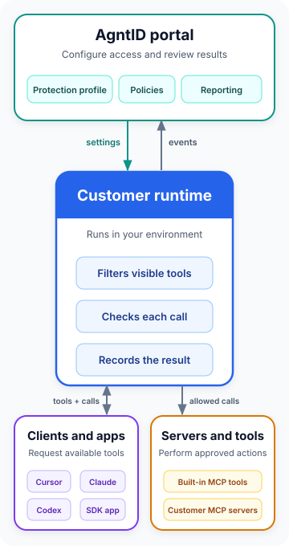
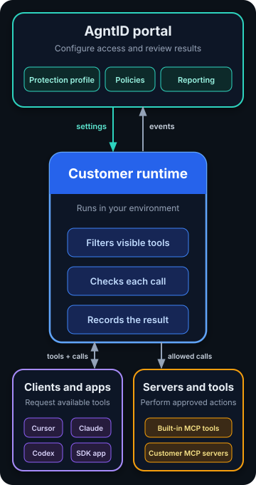

# Control which tools AI agents can see and use

AgntID places access controls between AI clients and their tools. A customer-hosted runtime filters the available tools, checks every call, and sends the result to the [AgntID portal](https://app.agntid.ai/) for reporting.

[Start the Quick Start](quick-start.md){ .md-button .md-button--primary }
[Connect an MCP client](mcp/connect-clients.md){ .md-button }
[Download documentation](downloads.md){ .md-button }

<section class="home-download-panel" aria-labelledby="home-download-title">
  

    Portable documentation
    <h2 id="home-download-title">Bring AgntID guidance into your coding workspace</h2>
    
Use one focused Markdown file with a coding assistant, or download the complete approved documentation with images and assets.

  

  

    <a class="md-button md-button--primary" href="downloads/agntid-context.md" download>Download AI-ready Markdown</a>
    <a class="md-button" href="downloads/">See all download options</a>
  

</section>

## What do you want to do?

  <a class="flow-card home-task-card" href="quick-start/">
    <h3>Set up AgntID</h3>
    
Deploy and connect a runtime, review its protection profile, and run a protected tool.

  </a>
  <a class="flow-card home-task-card" href="mcp/attach-server/">
    <h3>Add MCP tools</h3>
    
Add an MCP server in the portal and review which discovered tools are available.

  </a>
  <a class="flow-card home-task-card" href="mcp/connect-clients/">
    <h3>Connect a client</h3>
    
Generate the configuration for Cursor, Claude, or Codex and connect it to the runtime.

  </a>
  <a class="flow-card home-task-card" href="simulator/">
    <h3>Test access</h3>
    
Send a plain-English request and compare an allowed tool call with a denied one.

  </a>
  <a class="flow-card home-task-card" href="sdk/">
    <h3>Build with an SDK</h3>
    
Connect an application to AgntID and handle tool results and denials in code.

  </a>

## How AgntID protects tools

  
  

1. **Configure access in the [AgntID portal](https://app.agntid.ai/).** Register a runtime, add MCP servers, choose a protection profile, and add tool-specific policies when needed.
2. **Enforce access in your environment.** The protection profile creates the starting tool list. Tool review, individual settings, and user roles can reduce it. The runtime checks policy whenever a visible tool is called.
3. **Run the tool or stop the call.** An allowed call reaches its MCP server. A denied call stops at the runtime. Both outcomes are available in Reporting.

## Learn more

- [Understand MCP tool visibility](mcp/index.md#how-tool-visibility-works)
- [Troubleshoot a connection or tool call](troubleshooting.md)
- [View detailed flow diagrams](flows.md)
- [Read the release notes](release-notes.md)
