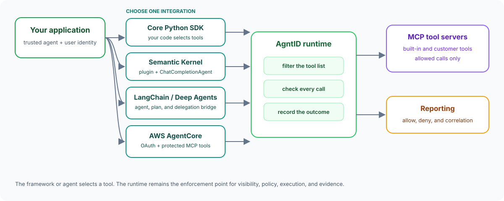
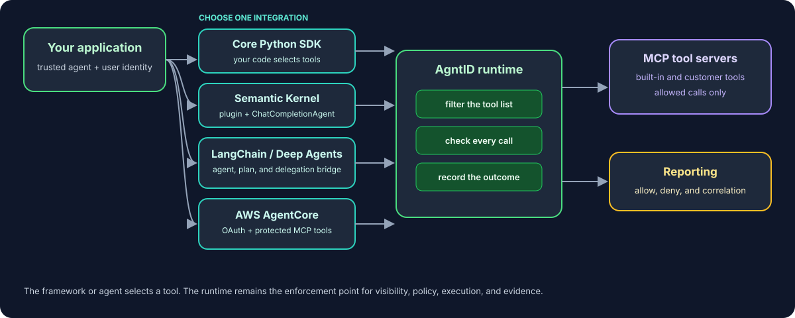

# Use the AgntID SDK

Connect Python agents to protected MCP tools. The SDK records the user request, keeps every tool call linked to it, returns clean results, and makes policy denials easy to handle.

Start with the [Python Quick Start](python.md) to run one protected tool without an AI model.

  
  

## Choose a path

| Your goal | Start here |
| --- | --- |
| Check the SDK and runtime without an AI model | [Python Quick Start](python.md) |
| Add task tracking to your own Python tool calls | [Python SDK Guide](python-guide.md) |
| Use a `ChatCompletionAgent` | [Microsoft Semantic Kernel](msk.md) |
| Use LangChain agents or Deep Agents | [LangChain and Deep Agents](langchain.md) |
| Run LangGraph locally or on AWS AgentCore with OAuth-protected tools | [AWS AgentCore](agentcore.md) |
| Run a complete repository example | [Examples](examples.md) |
| Look up a class, function, or constant | [API Reference](api-reference.md) |

## What the SDK adds

| Feature | What it means for your application |
| --- | --- |
| **Task lifecycle** | One task records the agent, user, and original request for a run. |
| **Call correlation** | The wrapped client adds the task ID to each tool call. |
| **Protected tool discovery** | Your application receives only the tools available under the runtime's protection profile and other access controls. |
| **Prompt-aware tool binding** | Task open returns the runtime intent snapshot so the application can give the model only the tools shortlisted for the current request. |
| **Clean results** | Runtime-only fields are removed before the result returns to your agent. |
| **Clear denials** | A policy denial becomes a `DenialResult` with a readable reason. |
| **Framework context** | The LangChain adapter can also send bounded conversation, plan, delegation, and approval context. |

The SDK does not replace runtime policy. A framework may choose a tool, but the AgntID runtime still decides whether that call can run.

## Current Python support

The current source version is **0.2.0** and requires Python 3.10 or later. The base package includes the MCP client and the framework-neutral LangChain/Deep Agents adapter. Microsoft Semantic Kernel and OpenAI integrations use optional dependencies.

The published GitHub wheel is still version 0.1.1. The guides for the new adapters therefore use a source checkout until a 0.2.0 release is published.

## Basic request flow

1. Connect to the runtime MCP address.
2. Read the profile-filtered tool list.
3. Create and open one task for the user request.
4. Filter the visible tools with the task's intent snapshot before model planning.
5. Call tools through the wrapped client.
6. Let `task_context` close the task.
7. Review the result or policy denial.

## What’s next

- [Run the Python Quick Start](python.md)
- [Add Microsoft Semantic Kernel](msk.md)
- [Add LangChain or Deep Agents](langchain.md)
- [Run the AWS AgentCore example](agentcore.md)
- [Connect Cursor, Claude, or Codex](../mcp/connect-clients.md)
